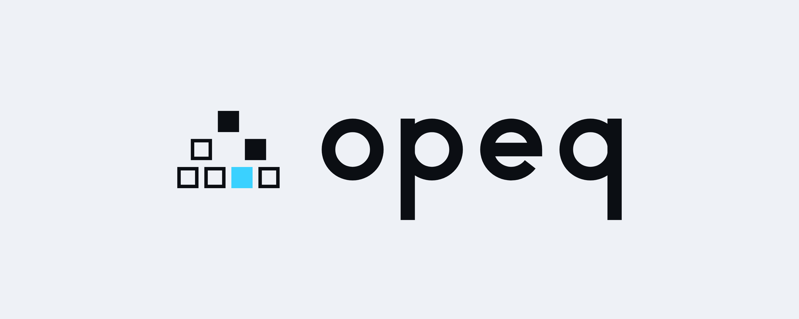

<picture>
  <source media="(prefers-color-scheme: dark)" srcset="assets/logo-dark.png">
  
</picture>

# opeq

Solana wallets built to resist quantum computers, usable with any Solana program.

Every Solana wallet today is protected by Ed25519. A large enough quantum computer running Shor's algorithm recovers an Ed25519 private key from its public key, and on Solana the address *is* the public key. opeq replaces that signature with a hash-based one whose security rests only on SHA-256, without any change to the Solana protocol.

> **Status: devnet only.** The program and the wallet have been through internal adversarial reviews and a full test suite. The program is still upgradeable by a single admin wallet (see below). Do not put real funds in it.

## What it does

- **A normal Solana address.** Your opeq wallet is a program-derived address with no Ed25519 private key behind it. The only secret is your 24 recovery words, which produce hash-based keys. It receives SOL, holds SPL and Token-2022 tokens, and other programs see it as an ordinary signer.
- **Any program, one signature.** One hash-based signature authorizes a list of instructions to any programs. Tested on devnet: SOL transfers, SPL Token, Token-2022, Memo, Associated Token Account creation, and Raydium CPMM swaps.
- **Stable address.** One key tree signs 688 wallet transactions (the program accepts up to 1008; the wallet keeps the rest for safe rekeys and device takeovers). A rekey moves the wallet to a fresh tree; the address and balances stay the same.
- **24 recovery words.** Every tree is derived from one 256-bit master seed shown as standard BIP39 words. The words never change, even after many rekeys, and restore the wallet with no files.
- **Quantum-safe upgrades.** The program's upgrade authority is itself an opeq wallet, so a broken Ed25519 key cannot change the code. On devnet that authority is one admin wallet held by the developer, which means the developer can still upgrade the program. Mainnet governance is an open decision (see Before mainnet).

## Browser extension

**OPEQ Wallet (Devnet)** is on the Chrome Web Store. The source is in `extension/` and shares `web/lib` with the opeq.io web wallet.

- Toolbar popup and a full-tab view, no permissions except `storage` (in-memory session only)
- Network fees are paid by a small Ed25519 fee key derived from the same 24 words. It has no power over the wallet; the wallet tops it up from inside its own signed transactions
- One active copy per wallet: a recovered copy must choose *Use on this device* (a rekey) before it signs, and any other copy then stops signing. This prevents two installs from ever signing the same one-time key
- Build: `python3 build_extension.py` (output in `build/extension`, `--zip` for the store package)

## How it works

| Piece | Choice |
|---|---|
| One-time signature | WOTS+ with n = 16 bytes, w = 256 (16 message + 2 checksum chains, 288-byte signature) |
| Many-time key | Merkle tree of height 10 over 1024 one-time keys (160-byte auth path), last 16 leaves reserved for rekey |
| Hashing | SHA-256 truncated to 16 bytes, tweaked with a per-account public seed and an address field, in the style of SPHINCS+ / SLH-DSA |
| Security target | about 128-bit classical and 64-bit quantum per one-time key, the same category as SLH-DSA-128 |
| Signed message | randomizer, domain tag, program id, account id, epoch, leaf, expiry slot, every inner instruction (program, accounts, flags, data), salt |
| Cost | the client grinds a 32-bit salt so verification needs about 1275 hash steps: roughly 160k compute units for a transfer, 200k for a Raydium swap |

On chain there are two addresses per wallet:

- a **state** account owned by the program (Merkle root, public seed, next leaf, epoch), and
- the **wallet** itself, a data-less PDA that the program signs for with `invoke_signed` after a valid signature.

The program checks the expiry slot, refuses any leaf below the on-chain counter, recomputes the message digest from the instruction it received, verifies the WOTS+ chains and the Merkle path, advances the counter, and only then performs the CPIs.

Transaction fees are still paid by an ordinary Ed25519 account. Breaking that key costs its owner the fee balance, never the opeq wallet.

## Built from scratch

There is no Rust, LLVM or Solana CLI in this repository. Everything is plain Python 3:

| File | Purpose |
|---|---|
| `wots.py` | WOTS+ and the Merkle tree |
| `protocol.py` | wire format, digests, state layout |
| `asm.py` | sBPF v3 assembler and strict ELF writer |
| `program.py` | the on-chain program, written in assembly through `asm.py` |
| `emu.py` | an sBPF interpreter with Solana syscalls, CPI checks and compute-unit accounting |
| `refmodel.py` | reference model of the program, used as a test oracle |
| `test_emu.py` | program tests and differential fuzzing against the reference model |
| `test_client.py` | client tests against a fake chain that runs the real program in the emulator |
| `deploy.py` | upgradeable loader deploy and upgrade |
| `v0.py` | versioned transactions and address lookup tables |
| `keystore.py` | scrypt + AES-256-GCM key storage with a whole-file HMAC |
| `mnemonic.py`, `wordlist.py` | 24-word recovery phrase (BIP39 English list) and per-epoch tree derivation |
| `opeq.py` | command line client |
| `token_demo.py`, `swap_demo.py` | token and Raydium demos |

The emulator's compute-unit count matched devnet within 0.05%.

## Quick start (devnet)

Requirements: Python 3.10+ and the `cryptography` package.

```
python3 test_emu.py          # program tests + fuzzing
python3 test_client.py       # client tests on a simulated chain

python3 deploy.py newkey                 # fee payer, fund it from faucet.solana.com
python3 program.py build/opeq.elf
python3 deploy.py deploy --elf build/opeq.elf --program-key opeq-program.json

python3 opeq.py keygen --program <PROGRAM_ID>      # shows 24 words, then asks for a password
python3 opeq.py init
python3 opeq.py status
python3 opeq.py send --to <ADDRESS> --sol 0.01
python3 opeq.py rekey
python3 opeq.py backup                               # show the 24 words again
python3 opeq.py recover --program <PROGRAM_ID> --vault restored.json
```

The vault file holds the encrypted master seed. Keep one copy in use at a time: two machines signing from the same file can reuse a one-time key. `recover` reads the on-chain counter and skips 64 keys, and `restore` does the same for an older copy of a vault file.

## Devnet deployment

| | Address |
|---|---|
| Program | `424ckcA6GGswYmQbrGjQmzdfhk4G9eB2zD1gK8xLw7sN` |
| Upgrade authority (an opeq wallet) | `FoWCn5Rj4jPuMLqpUSQ7KkQrMK5RhFNNhzs6ZLsxxzdm` |

## Before mainnet

- final decision on upgrade governance (immutable, or quantum-safe multisig with a timelock)
- deploy mainnet with a fresh program keypair, never the devnet one (`deploy.py` refuses a key that already exists on devnet); a vault binds itself to the cluster it first signs on and refuses other clusters
- done 2026-10-12: the live devnet program runs v1.1, which caps a signature's expiry at 300 slots ahead on chain so no client can ever emit a non-expiring authorization. It was upgraded through its own quantum-signed exec (transaction `5fYWB4XrtyUvStFVPU5qD9c8iWjpFtBJ4LqSFJzthN7Swd6svEcdB7jJ6AVbakG9fevstDLJMbT55amsvMLw8GAD`), after the same self-upgrade path was rehearsed on test program `9MPeZzh3rdpJA88AtZ26j5yrDwcsdzWCzJ4jWoEQhBnG`

## License

Apache License 2.0, see [LICENSE](LICENSE). The license covers the code only. The opeq name and logo are not licensed for use by other projects.
